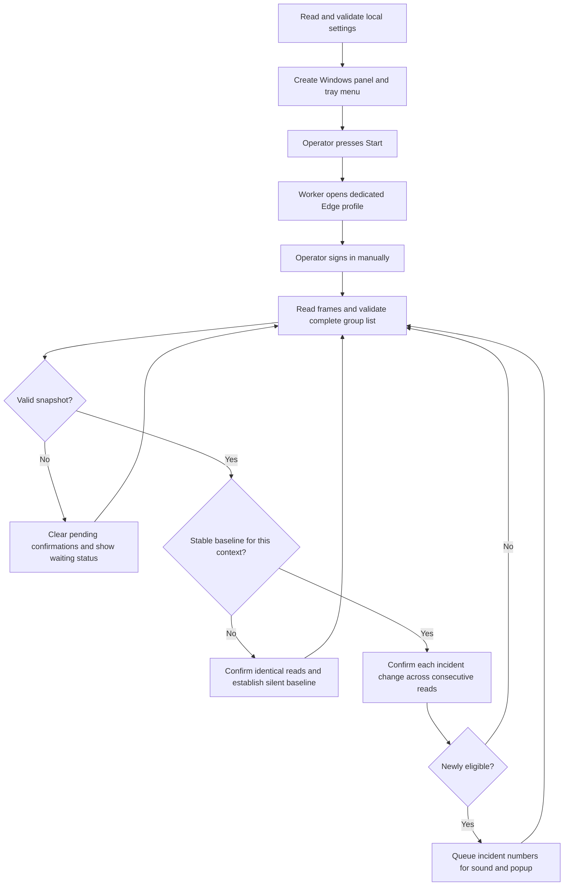

# Objectives and operating model

This guide explains what SNOW Edge Monitor is intended to do, how its components cooperate, and why a visible change in a ServiceNow list does not automatically become an alert. For installation and packaging commands, start with the [README](../README.md). A detailed [Portuguese guide](GUIA_DO_PROJETO.pt-BR.md) and [operational runbook](OPERATIONS.md) are also available.

## Purpose and intended use

SNOW Edge Monitor helps an operator notice relevant changes in an incident queue while working in an interactive Windows session. It reads the ServiceNow Classic list already available to the signed-in user, using an isolated Microsoft Edge profile controlled by Playwright. It presents local sound and popup notifications and remains accessible through the Windows tray.

The application observes what the current user's browser session can see. It does not supply ServiceNow privileges or replace the organization's incident-management process. A notification means that a record was newly observed or changed eligibility in a confirmed list snapshot; it does not prove that a record was newly created in the database.

## Project objectives

| Objective | Implementation | Acceptance evidence |
| --- | --- | --- |
| Preserve browser-based monitoring | Installed Edge is launched through Playwright's `msedge` channel. Authentication remains interactive. | Adapter code and the pending Windows checklist. |
| Make the app reusable | Instance, group sys_id, eligible states, timing and DOM selectors live in a local JSON configuration. | Configuration validation tests and a fictional example. |
| Avoid navigation-driven alerts | Complete-list checks precede detection; changed valid contexts silently establish a new baseline. | Synthetic pagination, filtering, sorting and refresh tests. |
| Detect useful changes | Previously unseen eligible records and confirmed ineligible-to-eligible transitions can alert. | State-machine tests and two extraction-to-detection browser tests. |
| Keep Windows interaction responsive | Tk runs on the main thread; browser work and tray commands use a queue and stop event. | Worker lifecycle tests and manual desktop checks still to execute. |
| Protect source publication | Local settings, profiles and generated files stay outside versioned source. Historical source is sanitized. | Release audit and the initial review report. |
| Support maintenance | Browser adaptation, policy, scheduling and presentation are independent modules. | Architecture documentation, fixtures and automated tests. |

## Boundaries

This version reads ServiceNow Classic incident lists. It does not implement REST API integration, automatic assignment, incident updates, credential management, multi-page aggregation, background Windows service execution, email/chat notifications or historical incident storage. Workspace, Shadow DOM and virtualized lists need a dedicated adapter before they can be monitored safely.

An interactive Windows desktop, installed Edge, compatible list metadata and a sufficiently small complete group list are prerequisites. Windows builds and desktop behavior require the checks in [WINDOWS_VALIDATION.md](WINDOWS_VALIDATION.md); Linux browser tests are not evidence that Windows audio or tray behavior passed.

## End-to-end flow

Polling waits are interruptible. At the refresh interval the worker clears pending candidates and reloads the controlled page. A same-context reload retains confirmed history; it does not turn the returning list into a set of new incidents. Stop releases the dedicated context. Restart creates a new detector and a new silent baseline.

## What constitutes a trusted snapshot

A snapshot contains a context digest and a sorted collection of incident number/state pairs. It enters the detection engine only after all of the following checks:

1. Exactly one visible matching table is found in a frame, and exactly one valid list exists across the controlled page's frames.
2. The document is complete, has no `aria-busy="true"` indicator, and the adapter has observed a quiet network read after document/XHR/fetch activity.
3. The frame belongs to the configured HTTPS origin and incident-list path.
4. The effective filter contains the configured group alone, with optional supported ordering and `EQ` directives. Additional filters are rejected.
5. Number, state and assignment-group columns are identified unambiguously. Selection columns cannot shift those mappings.
6. Every number matches the incident format, is unique, and has a nonempty state. Every row exposes the configured group's sys_id.
7. The first row is the start of the list and the number of captured rows equals the advertised total. An empty list needs an advertised total of zero.

GlideList2 metadata is preferred; configured DOM selectors are the fallback. Missing metadata is an invalid read, not permission to estimate a total. See [ARCHITECTURE.md](ARCHITECTURE.md) for the adapter contract.

## Baseline, eligibility and confirmation

The baseline is the detector's confirmed in-memory knowledge of each incident's latest state. It is not a file or a database. A scope digest captures the accepted frame URL, effective query and header mapping. A changed accepted scope disarms detection and requires a fresh baseline.

During startup the entire number/state mapping must remain identical for `confirmation_reads` accepted reads. Existing records are then learned silently, even if they are already eligible. After the detector is armed, changes are confirmed independently per incident. An unrelated row changing does not reset every candidate.

| Observation after arming | Outcome after confirmation |
| --- | --- |
| Unseen record in an eligible state | Alert. |
| Unseen record in an ineligible state | Learn the state silently. |
| Known ineligible record becomes eligible | Alert. |
| Known eligible record changes to another eligible state | Update silently. |
| Known record becomes ineligible | Update silently. |
| A confirmed ineligible record later becomes eligible again | A new alert is allowed. |
| A known row disappears and returns with the same state | No alert from reappearance alone. |
| Partial page, login page, loading or invalid group/filter | No detection; clear pending confirmations. |
| Changed accepted URL, order/query or header layout | Establish a fresh silent baseline. |

Consecutive means uninterrupted valid observations of the same candidate state. One observation followed by a failed read is insufficient. While an invalid read clears pending changes, it preserves an already confirmed same-context baseline.

### Fictional timeline

Assume eligible state values are `1` and `2`, and two confirmations are required:

| Read | Visible fictional data | Result |
| --- | --- | --- |
| 1 | `INC0000001` in `6` | First baseline observation. |
| 2 | Same | Baseline armed without sound. |
| 3 | Existing row plus `INC0000004` in `1` | New candidate, no alert yet. |
| 4 | Same | Alert once for `INC0000004`. |
| 5 | Same | No repeated alert. |
| 6 | `INC0000001` changes to `2` | State-change candidate. |
| 7 | Same | Alert once for `INC0000001`. |

The numeric values are examples, not a universal state mapping. If the DOM supplies display labels instead of `data-value`, configure labels such as `New` only after verifying the target instance.

## Timing and delivery limits

`poll_seconds` controls the delay between worker iterations. `refresh_seconds` controls when a browser reload is attempted. `failure_seconds` controls when an unavailable-list warning is reported once per outage. These values must be positive finite numbers; confirmation reads must be an integer of at least two.

The detector needs consecutive accepted observations, so the notification delay includes the polling delay, page loading and confirmation. `poll_seconds` is not a delivery guarantee. A change that appears and disappears between reads, during baseline establishment, or while the list is invalid can be missed. Frequent reloads or continuous application network activity can prevent confirmation.

A group with more records than fit on one accepted page causes monitoring to pause. The requested `page_limit` does not override server limits. This is the current design's main completeness tradeoff: paging cannot expose an old record and make it look newly eligible.

## Local notifications and privacy

Each alert event can play a generated three-second WAV asynchronously. The popup groups pending numbers until acknowledgment. Acknowledgment closes the popup and stops sound. The tray provides Show, Start, Stop, Test alert and Exit commands. Sound and popup can be independently disabled; disabling both removes those visible/audible incident notifications.

Instance settings and the dedicated browser profile remain local. The profile contains the authentication state created by ordinary browsing and is not a distributable artifact. Only the required number/state/group cells are extracted; unrelated columns are blanked before leaving JavaScript. Application logs show generic status/count information and exception types. Alert numbers remain in memory and the popup, without being written to diagnostic files.

## Maintenance and evidence

Start changes with fictional HTML fixtures. Preserve origin, query, group, uniqueness and complete-list assertions when adapting to a new ServiceNow layout. Run unit tests, the actual-JavaScript browser suite, the release audit and applicable Windows checks. The [review report](REVIEW_REPORT.pt-BR.md) records the initial 44 unit tests and 18 offline browser tests and explicitly distinguishes pending Windows checks.
